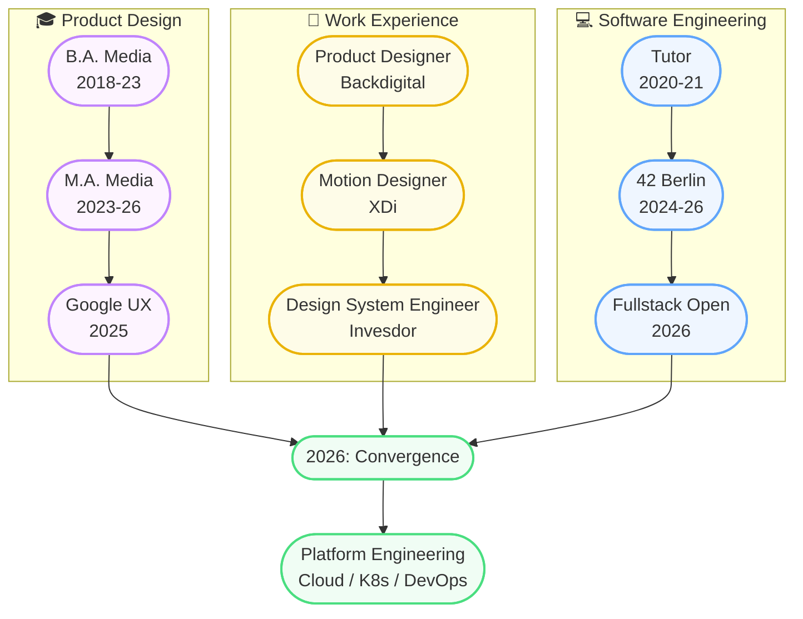

  

<h3 align="center">Sergej Gavrilov · @Kopfdreher</h3>

Product Designer turned Software Engineer — 42 Berlin

  <a href="https://sgavrilov.de">Website</a> ·
  <a href="https://www.linkedin.com/in/sergej-gavrilov/">LinkedIn</a>

---

### 🛠️ Tech Stack

  

  <b>Currently:</b> TypeScript · JavaScript · C / C++ · Unix · <b>Also:</b> Go · Vue · Node.js · Next.js · PostgreSQL · Docker · Bash · Figma · Creative Cloud

---

### 🌳 Learning Path

| 🎓 Design Education | 💼 Jobs | 💻 Engineering |
|---|---|---|
| B.A. Media Production, OWL (2018–23) — 1.6 | Product Designer, Backdigital (2021–23) | Programming Tutor, OWL (2020–21) |
| M.A. Media Production, OWL (2023–26) — 1.4 | Motion Designer, XDi (2024–25) | 42 Berlin Core — C/C++ & Unix (2024–26) |
| Google UX Certificate (2025) | Design System Engineer, Invesdor (2025–26) | Fullstack Open, Helsinki (2026) |
| | | **2026 → Platform Engineering:** Cloud, K8s, CI/CD, Go |

---

### 📂 Work

- **Code:** Check pinned repos for current 42 / C++ projects
- **Design:** Full portfolio at [sgavrilov.de](https://sgavrilov.de)
