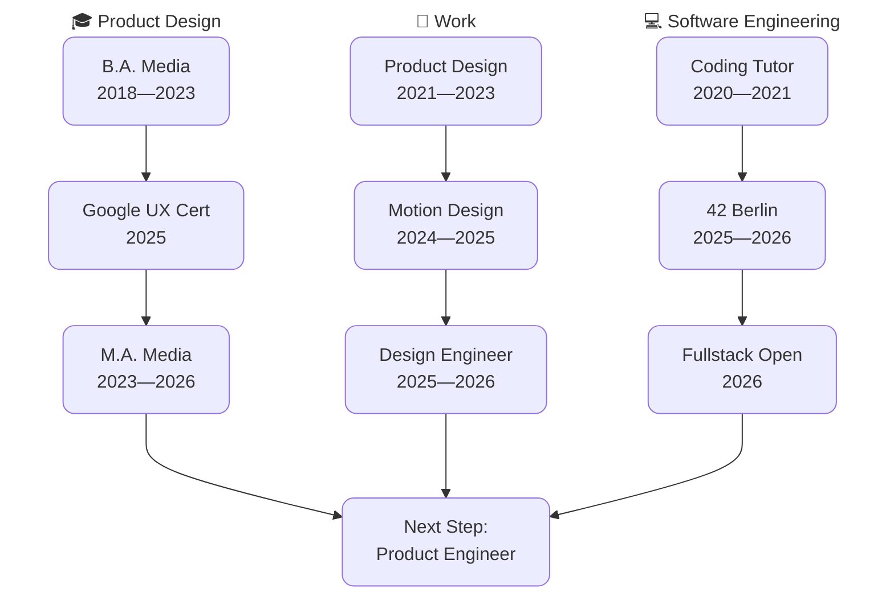

  

---
### 🛠️ Tech Stack

  

  <b>Currently:</b> TypeScript · JavaScript · React · <b>Also:</b> Vue · Go · Node.js · Next.js · PostgreSQL · Docker · C / C++ · Bash · Unix · Figma · Creative Cloud

---

### 🌳 Learning Path

---

### 🎓 Education

| 🎨 Product Design | 💻 Software Engineering |
|---|---|
| Google UX Certification, Coursera | Coding Tutor, TH-OWL |
| Bachelor in Media Production, TH-OWL | Curriculum, 42 Berlin |
| Master in Media Production, TH-OWL | Fullstack Open, Helsinki |

---

### 💼 Work

| Role |
|---|
| Product Designer, Backdigital (2021-2023) |
| Motion Designer, XDi (2024-2025) |
| Design Engineer, Invesdor (2025-2026) |

