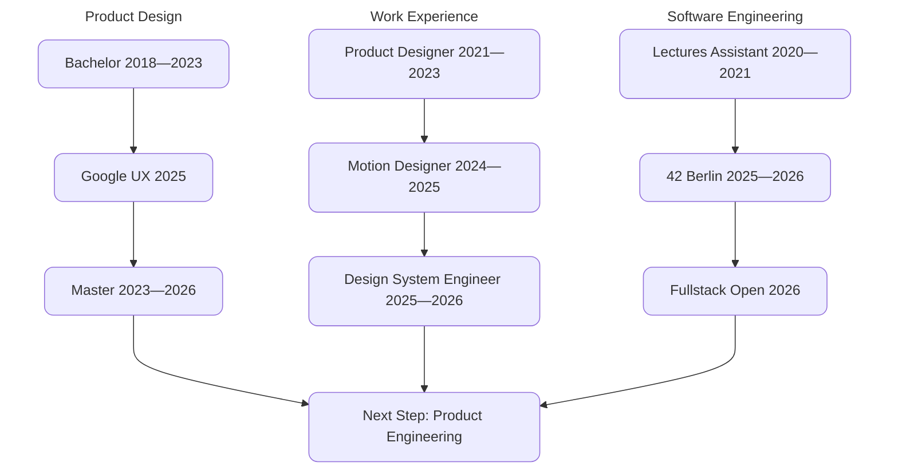

  

<h3 align="center">Sergej Gavrilov · @Kopfdreher</h3>

Product Designer turned Software Engineer — 42 Berlin

  <a href="https://www.linkedin.com/in/sergej-gavrilov/">LinkedIn</a>

---

### 🛠️ Tech Stack

  

  <b>Currently:</b> TypeScript · JavaScript · React · <b>Also:</b> Vue · Go · Node.js · Next.js · PostgreSQL · Docker · C / C++ · Bash · Unix · Figma · Creative Cloud

---

### 🌳 Learning Path

#### 🎓 Product Design 
- B.A. Media Production, OWL (2018–23) — Grade 1.6
- Google UX Certificate (2025) 
- M.A. Media Production, OWL (2023–26) — Grade 1.4

#### 💻 Software Engineering 
- Programming Tutor, OWL (2020–21)
- 42 Berlin Core — C/C++ & Unix (2024–26)
- Fullstack Open, Helsinki (2026)

### 📂 Work
- Product Designer, Backdigital (2021-2023)
- Motion Designer, XDi (2024-2025)
- Design System Engineer, Invesdor (2025-2026)

